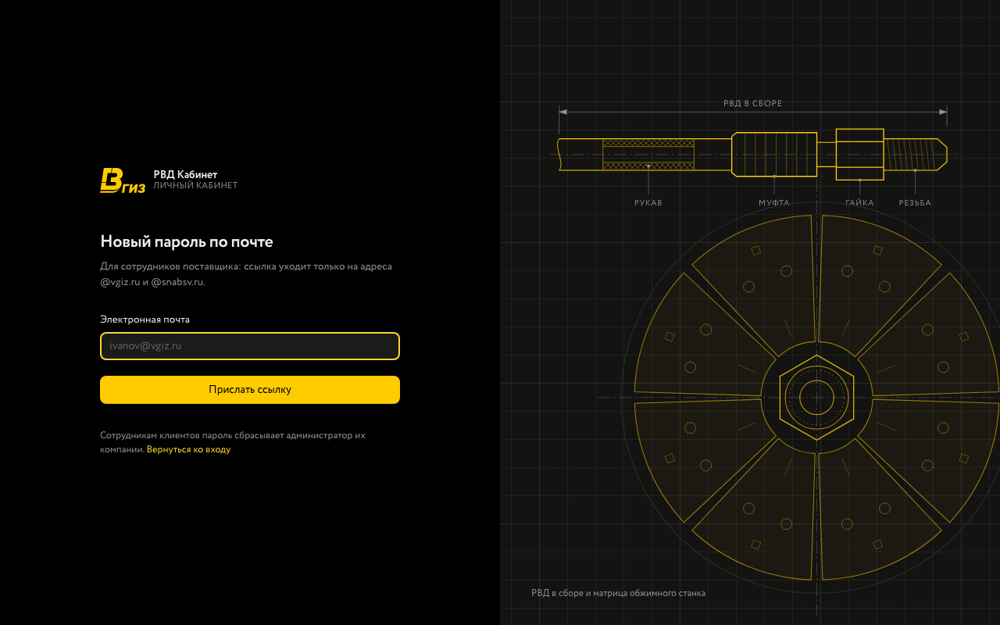
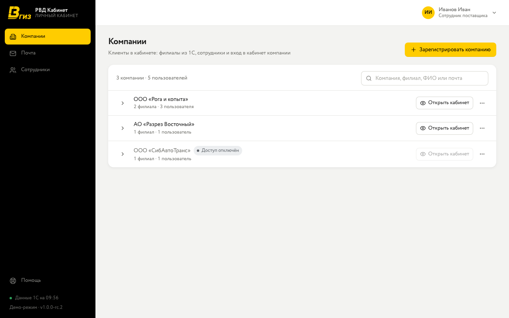
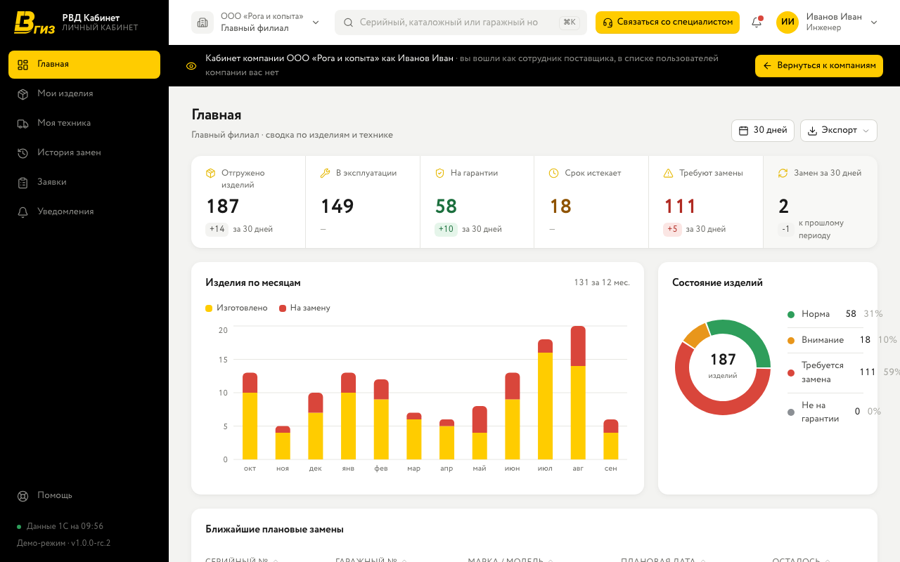
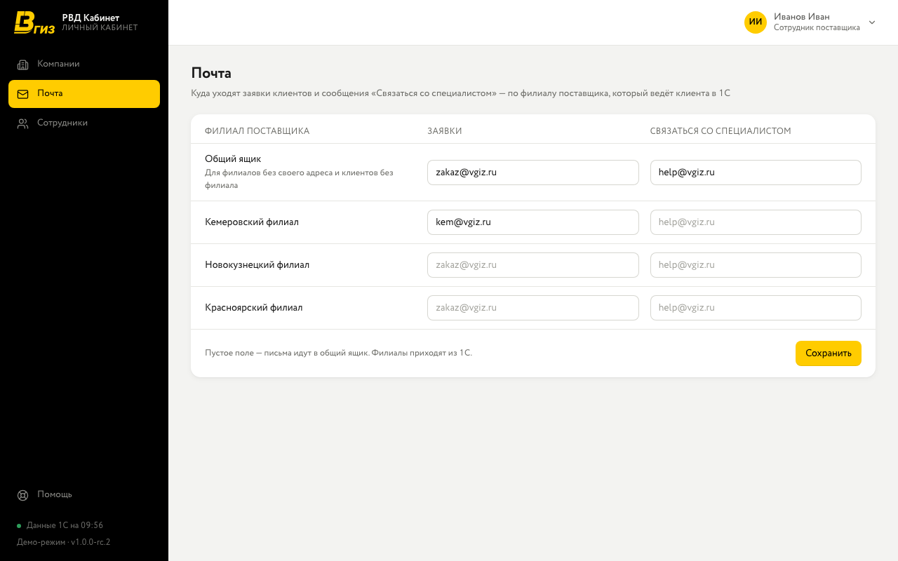

Раздел поставщика — для сотрудников ВГИЗ. Здесь регистрируют компании-клиентов, смотрят кабинет любой компании её глазами, настраивают почту для заявок и добавляют коллег. Данных об изделиях в самом разделе нет: они в кабинетах компаний.

## Вход

- **Первый вход.** Откройте clientrvd.vgiz.ru, нажмите «Забыли пароль?», введите свою почту и задайте пароль по ссылке из письма. Ссылка действует 48 часов, только один раз.
- Ссылка уходит **только на адреса @vgiz.ru и @snabsv.ru**. Сотрудникам клиентов пароль сбрасывает администратор их компании или вы — кнопкой «Новая ссылка» в разделе «Компании».
- После нескольких неудачных попыток вход временно блокируется — подождите указанное время.

## Компании

Все компании-клиенты кабинета. Одна строка поиска ищет по названию компании, её филиалам, ФИО и почте пользователей; если нашёлся пользователь, его компания раскрывается.

- **Зарегистрировать компанию.** Отметьте её клиентов 1С (поиск по названию или ИНН). Несколько клиентов станут филиалами одной компании. Название подставится из первого клиента — его можно изменить. Укажите ФИО и почту администратора компании: ему придёт приглашение, дальше своих сотрудников он заводит сам. Новый клиент 1С появляется в списке после синхронизации с 1С.
- **Раскрыть компанию** (стрелка слева) — её клиенты 1С и пользователи с ролями.
- **Новая ссылка** — пользователю, который не получил или потерял приглашение, уйдёт новое письмо.
- **⋯ → Добавить филиал** — ещё один клиент 1С в той же компании.
- **⋯ → Отключить доступ** — сотрудники компании сразу выходят из кабинета и не могут войти, пока доступ не включат снова. Данные и пользователи сохраняются.

## Кабинет глазами клиента

- **Открыть кабинет** — вы входите в кабинет компании как её администратор. В списке пользователей компании вас нет.
- **Войти как** — вы видите кабинет так же, как этот пользователь: его роль, его филиалы. Сменить его пароль нельзя.
- Пока вы в чужом кабинете, под шапкой — чёрная полоса с названием компании. **«Вернуться к компаниям»** — назад в раздел.
- Всё, что вы сделаете в кабинете компании, — настоящее: заявка уйдёт менеджеру, изменение запишется в журнал компании с вашим именем («вход сотрудника поставщика»).

## Почта

Куда уходят заявки клиентов и сообщения «Связаться со специалистом». Письмо идёт на адрес того филиала поставщика, который ведёт клиента в 1С; если у филиала адреса нет — на **общий ящик**. Пустое поле означает «как в общем ящике». Список филиалов приходит из 1С.

## Сотрудники

Коллеги, у которых есть доступ к разделу. «Добавить пользователя» — ФИО и почта (только @vgiz.ru или @snabsv.ru); пароль сотрудник задаёт сам через «Забыли пароль?». Отключить доступ — в карточке сотрудника.

## Если что-то не так

- **Компания не входит** — проверьте в «Компаниях», не отключён ли у неё доступ, и активен ли пользователь.
- **Клиента нет в списке при регистрации** — он уже филиал другой компании или ещё не пришёл из 1С (синхронизация ночью и каждые 10 минут).
- **Письма с заявками не приходят** — проверьте адреса в «Почте».
